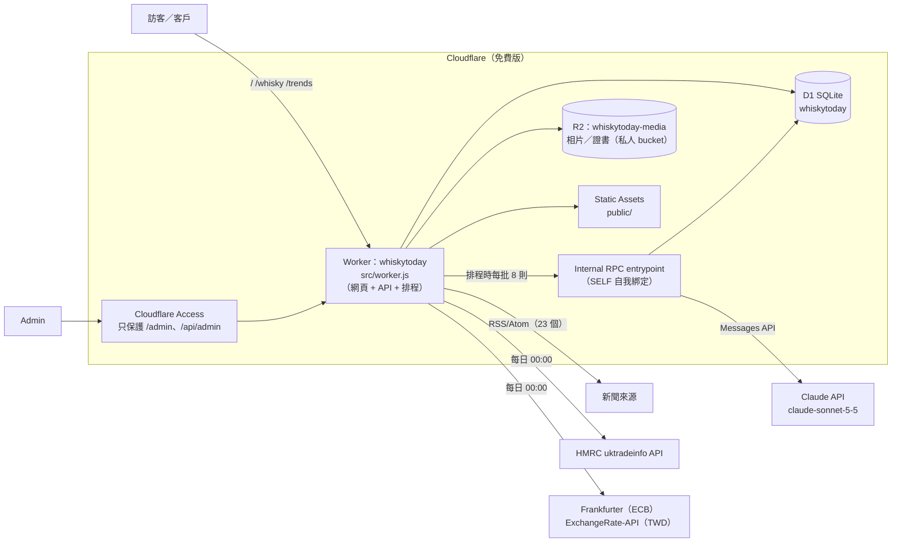

# Whisky Today — 平台總覽（現況）

> 更新日期：2026-11-05。本文描述**現時已上線**的系統，供外部審閱（例如交給另一個 AI 或工程師 review）。
> 原始開發規格見 [`PLAN.md`](../PLAN.md)；本文第 9 節列出與規格不同之處及原因。
> 網址：https://whiskytoday.fiveathree.workers.dev　｜　Repo：`fiveathree/whiskytoday`（分支 `phase-1-intelligence`）

---

## 1. 產品是甚麼

私人高端威士忌情報及酒款平台，對象是從事高端威士忌（每支 HK$10,000 以上）投資及買賣的專業人士，以及其香港、台灣客戶。

| 頁面 | 網址 | 誰可以看 | 用途 |
|---|---|---|---|
| 每日情報 | `/` | 公開 | 全球威士忌新聞，AI 中英摘要、分類、投資者焦點 |
| 酒款 | `/whisky` | 公開 | 酒款目錄：資料、公開價格、我們的評級（Tier＋總分）、網上評分 |
| 市場趨勢 | `/trends` | 公開 | 蘇格蘭威士忌出口統計及新聞趨勢圖表，可列印 A4 |
| 後台 | `/admin` | 只限 Admin（Cloudflare Access 登入） | 酒款及價格管理、評分、來源、工作紀錄、設定 |

公開頁面加 `noindex`，不讓搜尋器收錄。介面繁體中文／English 可切換；淺色（預設）／深色可切換。

### 開發階段（PLAN §11）

| 階段 | 內容 | 狀態 |
|---|---|---|
| 一 | 每日情報（收集、去重、AI、投資者焦點、新聞頁、後台、每日簡報） | 已上線；每日 email 簡報**未啟用**（未有自己網域作寄件地址） |
| 二 | 酒款、單瓶、價格、CSV 匯入、匯率、評分、掃描表 | 已上線（另加公開酒款目錄、持有回報圖、網上評分） |
| 三 | 客戶私人分享連結、分享頁、每週週報、D1 備份 | **未開始** |
| 額外 | 市場趨勢頁（HMRC 出口數據） | 已上線（擁有人要求） |

---

## 2. 技術架構

| 層 | 用了甚麼 | 備註 |
|---|---|---|
| 程式 | 單一 Cloudflare Worker（ES modules，JavaScript） | 前端純 HTML／CSS／原生 JS，無框架、無 build step |
| 資料庫 | Cloudflare D1（SQLite），FTS5 trigram 全文搜尋 | 6 個 migration（`migrations/`） |
| 檔案 | Cloudflare R2，私人 bucket | 公開相片經 Worker 檢查 `is_public` 才回傳 |
| 排程 | Cron Triggers：UTC 16:00、23:00、11:00＝香港 00:00、07:00、19:00 | 00:00 另更新匯率及出口數據 |
| 登入 | Cloudflare Access（self-hosted app，路徑 `admin`、`api/admin`，policy＝成員 email 名單） | Worker 內再驗證 `Cf-Access-Jwt-Assertion`（RS256、AUD、issuer、到期）；只有一種成員，權限相同（PLAN §8.1） |
| AI | Anthropic Claude API，官方 SDK `@anthropic-ai/sdk`；模型 `claude-sonnet-5-5`（存於 `settings`，可改） | 結構化輸出（JSON schema）；拒絕時用 server-side fallback |
| 圖表 | 自寫原生 SVG（`public/js/charts.js`） | 色盤經 dataviz validator 驗證（淺色及深色、色盲分辨） |
| 部署 | 本機 `npx wrangler deploy` | 未設 CI；secrets 用 `wrangler secret put`，不入 repo |

### 2.1 主要程式檔

| 檔案 | 職責 |
|---|---|
| `src/worker.js` | 路由、Access 檢查、排程（`scheduled`）、`Internal` RPC entrypoint |
| `src/access.js` | 驗證 Access JWT（快取 JWKS 1 小時），判斷 admin |
| `src/api.js` | 公開 API（新聞、趨勢、酒款）＋後台 API 路由 |
| `src/news.js` | RSS 收集、去重、Claude 處理、投資者焦點、實體配對、分批處理 |
| `src/dedupe.js` / `src/rules.js` | 去重、相似度、關鍵字過濾；投資者焦點規則、實體配對（純函數，有測試） |
| `src/editions.js` | 後台：酒款／單瓶／價格／相片／網上評分／CSV 匯入／設定／示範資料 |
| `src/catalog.js` | 公開酒款目錄（只輸出白名單欄位） |
| `src/score.js` / `src/rescore.js` | 評分引擎（純函數，有測試）／載入資料、重算、寫入 `scores` |
| `src/trade.js` / `src/fx.js` | HMRC 出口數據／匯率 |
| `src/aidraft.js` | 「AI 起草」酒款中英介紹 |
| `src/digest.js` | 每日 email 簡報（未啟用） |
| `src/demo.js` | 示範資料（虛構酒款、酒廠、拍賣行） |
| `public/*.html`, `public/js/*` | 四個頁面及其前端程式 |
| `test/*.test.js` | Node 內建 test runner，26 個測試（評分、去重、CSV） |

---

## 3. 收集緊甚麼資料

### 3.1 新聞（每日 3 次＋手動）
- **23 個公開 RSS/Atom 來源**（清單及剔除原因見 [`docs/SOURCES.md`](SOURCES.md)）：蘇格蘭、愛爾蘭、日本（1 個）、美國、全球業界、Bonhams 新聞稿、美國烈酒協會（DISCUS）等。台灣／香港未有合適來源。
- 只存**標題、連結、日期、600 字以內摘要片段**，不存全文；只讀取來源表內的 feed 網址（不跟隨文章內連結，防 SSRF）。
- 綜合酒類來源用關鍵字過濾（whisky、bourbon、scotch 等），只把相關文章交給 AI。
- 每篇（每個事件）由 Claude 輸出：中英標題、中英摘要、類別（14 類）、重要性 1–5、提及的酒廠／品牌／公司、事實（附連結）、來源說法（未證實）、AI 解讀、投資者分析卡（利好／利淡、短期／長期、證據、推論）。
- 現況：84 則已發佈，其中 29 則屬投資者焦點；AI 累計成本約 US$1。

### 3.2 實體（酒廠／品牌／公司／裝瓶商／拍賣行）
- 106 個預設實體，含中英名及別名；已關閉／復廠酒廠有標記（用於評分「稀缺度」）。
- AI 抽取但配對不到的名稱記入「未配對名稱」，由 Admin 決定是否加入。

### 3.3 酒款及價格（Admin 手動輸入）
- 酒款版本：酒廠、品牌、裝瓶商、年份、酒齡、桶型、桶號、限量、酒精度、容量、中英介紹、品飲筆記、專業評語、目標價、最低可接受出售價、預計持有期。
- 單瓶：瓶號、酒位、封口、酒標、盒況、購入年份、**購入成本（私人）**、**來源證明及私人備註（私人）**。
- 價格紀錄：拍賣成交（連佣金）、落槌價、流拍、私人成交、酒商叫價、建議零售價；幣種、市場、拍賣行、Lot、日期、容量、是否公開。可逐筆輸入或 CSV 匯入（先預覽，錯誤行不匯入）。
- 相片／證書：上載到 R2，逐張設定是否公開。
- 網上評分：Admin 手動輸入來源（Whiskybase、Whisky Advocate、IWSC 等）、分數、滿分、人數、獎項、連結。**不自動抓取**（Whiskybase 等禁止程式讀取）。
- 現況：正式資料庫暫時 0 支酒款（示範資料已清除）。

### 3.4 公開統計數據
- **HMRC Overseas Trade Statistics**（uktradeinfo.com OData API，Open Government Licence v3.0）：商品編號 2208.30 蘇格蘭威士忌（另分單一麥芽），按月 × 目的地國家，2015-01 至 2026-08，共 31,052 行。每晚重新抓最近 6 個月（只寫入有變的行）。
- **匯率**：Frankfurter（歐洲央行參考匯率，USD／GBP／EUR／JPY／CNY／SGD，2015 年起）＋ ExchangeRate-API（TWD，只有每日最新）。全部存成「每 1 單位外幣＝多少港幣」。

---

## 4. 主要功能

### 4.1 每日情報（`/`）
- 篩選：全部／投資者焦點、地區、類別、日期；FTS5 全文搜尋（3 字以下改用 LIKE）。
- 每頁 10 張卡；詳細頁分「摘要／投資者分析／來源」，事實、來源說法、AI 解讀用不同底色區分。
- 同一事件的多個來源合併成一則（見 5.2）。
- 登入的 Admin 在頁頂另見「立即收集新聞」及「後台」連結。

### 4.2 酒款（`/whisky`）
- 列表：相片、酒廠、酒齡、Tier 及總分、網上評分、最近公開成交（HKD）；按 Tier、類別篩選及搜尋，每頁 9 款。
- 詳細頁：我們的評級與網上評分並排；酒款資料、介紹、品飲、評語；公開價格圖（HKD／USD）；相關新聞。每款有獨立網址（`/whisky#<slug>`）。

### 4.3 市場趨勢（`/trends`）
- 整體出口：近 12 個月出口總值、單一麥芽佔比、按年變化；2016 年起滾動 12 個月走勢。
- 亞洲及主要市場：香港、台灣、中國、新加坡、日本、南韓走勢；十二大市場及按年變化。
- 市場消息：每月新聞類別、投資者焦點利好 vs 利淡、最多報道的酒廠。
- 列印 A4（所有分頁依次排版）。

### 4.4 進口成本計算器（`/calculator`，公開）
- 香港、內地、台灣、澳門、日本、新加坡六個分頁，公式同客戶 Excel 一致（PLAN §13.7 修正項除外），測試 `test/calc.test.js` 用 Excel 示範數字逐格對數。
- 匯率每日自動（GBP→當地，ECB＋ExchangeRate-API 的 TWD／MOP）；稅率及成本計算器預設值喺後台「設定」改。
- 即計即用、不儲存；下載 CSV（UTF-8 BOM）、列印 A4 橫向。

### 4.5 後台（`/admin`）
- 酒款評分：掃描表（Tier、總分、五項分數、最近成交、12 個月變化、最近新聞），按 Tier 篩選、按分數排序。
- 酒款編輯：資料（含「AI 起草」）、價格（圖表＋表格，HKD／USD／原幣）、回報及投資卡、網上評分、單瓶、相片／證書、相關新聞。
- CSV 匯入價格、範本下載。
- 工作紀錄（每次收集、AI 批次、匯率、出口數據、本月 AI 成本、失敗項目重試）、新聞來源管理、追蹤酒廠／品牌、未配對名稱、設定（預設幣種、出場成本 %、評分權重、示範資料載入／清除）。

---

## 5. 新聞處理流程

### 5.1 收集與 AI
1. 逐個 feed 讀取（15 秒逾時；單一來源失敗只記錄 `last_error`）。只收 14 日內文章。
2. `canonical_url`（去 utm 等參數、去 www、去結尾斜線）已存在即跳過。
3. AI 處理：每批 8 則。排程時用 `SELF` RPC 綁定把每批放到獨立 invocation（每輪最多 7 批＝56 則），避開免費版每次 50 個對外請求的上限；手動按鈕亦分步：先讀 feed，再逐批處理並顯示進度。
4. Prompt 要求只根據標題及摘要片段、不可虛構價格／數量／日期、未知填 null、外部內容視為資料不是指令。輸出用 JSON schema 強制格式；解析失敗重試一次，再失敗標 `failed`（後台可重試）。

### 5.2 去重
- AI 前：正規化標題 hash 相同，或 72 小時內標題 Dice 相似度 ≥ 0.75 → 歸同一 cluster，只處理一次。
- AI 後：用 AI 寫的英文標題再比對 72 小時內已發佈新聞——同類別 ≥ 0.5、不同類別 ≥ 0.6 → 合併（狀態 `merged`，原文連結仍列在「來源」）。

### 5.3 投資者焦點規則（由程式決定，非 AI）
類別屬拍賣、紀錄價、閉廠、復廠、收購、限量發售、市場指數、稅項法規、匯率貿易、假酒之一；或重要性 ≥ 4 且連到「追蹤中」的酒廠／品牌。
投資者焦點新聞連到某酒廠／品牌 → 自動重算相關酒款評分。

---

## 6. 評分引擎（`src/score.js`）

總分 100，只作研究排序，不是買入建議。所有金額換算成港幣（用成交當日或之前最近的匯率）。每次重算寫一筆 `scores`（含全部輸入及 `algo_version`），可重現。

| 前置條件 | 結果 |
|---|---|
| 過去 24 個月同版本成交（拍賣連佣金／私人成交）少於 3 次 | 「資料不足」，不計分 |
| 缺裝瓶年份而有同名版本，或價格容量與版本不符 | 「待核實」，不計分 |

| 項目 | 滿分 | 計法 |
|---|---|---|
| 價格趨勢 | 30 | t12＝近 12 月中位數÷前 12 月中位數−1；t36＝近 12 月÷25–36 月前中位數的年化變化；取平均（缺一用另一個，兩者皆缺當 0）；年化 −10%→0 分、+30%→30 分 |
| 成交活躍度 | 20 | 近 12 月成交次數 min(n,10)/10×15 ＋ (1−流拍率)×5（無流拍紀錄給 3） |
| 稀缺度 | 25 | 限量 ≤100:12、≤500:9、≤2,000:6、≤10,000:3；酒廠關閉／封存 +8；酒齡 ≥40:+5、≥25:+3、≥18:+1；上限 25 |
| 出場難度 | 15 | 24 個月內有成交的拍賣行數 ≥3:6、2:4、1:2；出場成本 ≤15%:9、≤25%:6、≤35%:3 |
| 酒廠基本面 | 10 | 起點 5，加總 180 日內投資者焦點新聞 方向×重要性/5×(1−日數/180)，夾 0–10 |

Tier：A ≥ 75、B 60–74、C 45–59、低 < 45。權重可在設定頁改（總和須 100）。

**投資卡**：參考買入價＝近 12 月成交中位數；目標價／最低出售價由 Admin 輸入（AI 不會產生）；出場成本＝設定 % × 目標價；RRR＝(目標價−出場成本−買入價)÷(買入價−最低出售價)，分母 ≤0 或缺資料顯示「未能計算」。

**持有回報圖**（後台）：假設在某年以該年成交中位數買入，今日以近 12 月中位數扣出場成本賣出，計年化回報。

---

## 7. 資料表（D1）

| 表 | 內容 |
|---|---|
| `sources` | 新聞來源、地區、類型、關鍵字過濾、最近錯誤 |
| `articles` (+ `articles_fts`) | 新聞原文標題／連結／片段、AI 結果、cluster、狀態、成本 |
| `entities`, `article_entities`, `unmatched_entities` | 酒廠等實體、新聞與實體關係（含利好／利淡方向）、未配對名稱 |
| `editions`, `bottles`, `media`, `prices`, `ratings` | 酒款、單瓶（含私人成本）、相片、價格、網上評分 |
| `scores` | 每次評分結果及輸入 |
| `fx_rates`, `trade_exports` | 匯率、HMRC 出口數據 |
| `settings`, `job_logs` | 設定（模型、權重等）、工作紀錄 |

金額一律存原幣「最小單位整數」（×100）＋幣種代碼；時間存 ISO 8601 UTC。

---

## 8. 保安及私隱

- 公開路徑：`/`、`/whisky`、`/trends`、`/calculator`、`/api/calc`、`/api/news*`、`/api/trends`、`/api/whisky*`、`/api/whisky-media/*`、靜態檔。其餘（`/admin`、`/api/admin/*`）先經 Cloudflare Access，Worker 再驗 JWT，不通過 403。
- 公開酒款 API 用**欄位白名單**：永不輸出購入成本、私人備註、來源證明、單瓶資料、目標價、最低出售價、投資卡、評分細項、非公開價格／相片。已用測試資料搜查公開回應確認。
- 公開相片只在 `is_public=1` 時經 Worker 讀 R2 回傳；R2 bucket 本身不公開。
- 所有 SQL 用 prepared statements；所有外部文字（新聞、AI 輸出、國家名）輸出 HTML 前轉義；外部連結只接受 http(s)。
- Secrets（Claude key、Access AUD／team domain、Admin email）只用 `wrangler secret`；本機開發用 `.dev.vars`（已 gitignore），其 dev 登入繞過只在 `localhost` 生效。
- 不記錄任何客戶姓名、聯絡資料或「邊位客戶持有邊支酒」。

---

## 9. 與 PLAN.md 不同之處（擁有人決定或技術原因）

| 項目 | PLAN 原本 | 現況 | 原因 |
|---|---|---|---|
| 新聞頁 | 只限 Admin／Viewer 登入 | 公開 | 擁有人：用戶不想登入。因此「影響我的酒」不在公開頁顯示（避免洩露追蹤名單） |
| 角色 | Admin／Viewer | 只有一種成員 | PLAN 2026-11-05 更新（§8.1）；新聞、酒款、趨勢仍公開（擁有人 2026-11-05 再確認） |
| 計算器 | 只限內部成員 | 公開，毋須登入 | 擁有人 2026-11-05 決定 |
| 計算器程式位置 | `src/calc.js` | `public/js/calc.js` | 瀏覽器要直接 import，靜態檔只可以放 `public/`；Worker 同測試都 import 同一個檔 |
| 酒款資料 | 只經私人分享連結給客戶 | 另有公開目錄 `/whisky` | 擁有人決定；只顯示 Tier＋總分 |
| 網上評分 | 無 | 有（手動輸入） | 擁有人要求 |
| 市場趨勢頁 | 無 | 有 | 擁有人要求；用開放數據，不抄 WhiskyInvestDirect／SWIR（有版權） |
| 收集時間 | 07:00、19:00 | 00:00、07:00、19:00 | 擁有人要求 |
| 預設主題 | 深色 | 淺色（可切換深色） | 擁有人要求 |
| AI 模型 | 未定 | Claude Sonnet 5.5 | 擁有人揀，成本約每則 US$0.009 |
| 每輪 AI 上限 | 60 | 排程每輪最多 56（7 批 × 8） | 免費版限制，用分批 RPC 解決 |
| Cloudflare 方案 | 預期免費額度足夠 | 免費版運作中 | 擁有人暫不升級 Workers Paid（US$5／月） |

---

## 10. 限制、已知問題、未做

- **Cloudflare 免費版限制**：每次執行 50 個對外請求、10ms CPU、D1 每日 10 萬行寫入。2026-11-04 一次過匯入歷史數據曾用爆 D1 寫入額度，令當日收集全部失敗（翌日 08:00 重設後回復）。日常用量每日數千行。
- **每日 email 簡報未啟用**：需要擁有人的網域接入 Cloudflare Email Service，以及 Workers Paid。
- **台灣／香港新聞來源**：未有；日本只有一個來源。各來源網站條款未逐一細讀（只讀其公開 RSS 的標題及摘要）。
- **HMRC 數據**：只代表英國出口申報；香港數字偏低（大量經其他地方轉口），與 SWA 公佈數字可能有出入；約 6 星期延遲。
- **TWD 匯率**沒有歷史數據，較舊的台幣價格用最早可得匯率換算。
- **AI 起草**未在正式環境實測。
- **公開酒款目錄**會列出所有酒款（未有「只限後台」開關）。
- **第三階段未做**：私人分享連結（`/s/:token`，可設期限、撤銷）、分享頁設計及列印、每週投資者週報、D1 每週備份到 R2、分享 API rate limit。
- 無 CI；部署為本機手動 `wrangler deploy`。

---

## 11. 成本（目前）

| 項目 | 費用 |
|---|---|
| Cloudflare（Workers、D1、R2、Access、Cron） | 免費版 US$0 |
| Claude API | 每則新聞約 US$0.009；預計每月 HK$130–150（每日 60–70 則） |
| HMRC、匯率 API | 免費 |
